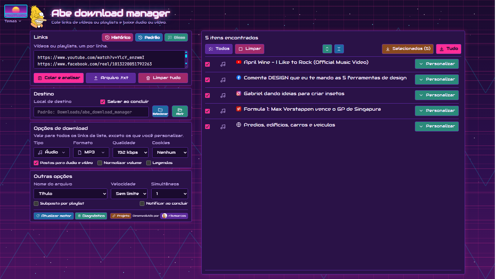

# Abe download manager

Aplicativo para Windows que baixa **áudio e vídeo** de YouTube, Instagram, TikTok, Facebook, G1, Pexels e centenas de outros sites. Cole os links (ou carregue um `.txt`), escolha formato e qualidade e baixe em lote, com progresso por item, trechos personalizados e 27 temas visuais.

> Funciona 100% localmente: nada é enviado para servidores de terceiros além das requisições aos próprios sites de onde você baixa.



## Sumário

- [Recursos](#recursos)
- [Instalação](#instalação)
- [Como usar](#como-usar)
- [Temas](#temas)
- [Desenvolvimento](#desenvolvimento)
- [Gerar os executáveis](#gerar-os-executáveis)
- [Estrutura do projeto](#estrutura-do-projeto)
- [API do backend](#api-do-backend)
- [Variáveis de ambiente](#variáveis-de-ambiente)
- [Limitações conhecidas](#limitações-conhecidas)
- [Licenças e avisos](#licenças-e-avisos)
- [Autor](#autor)

## Recursos

**Download**

- Áudio em MP3, M4A, WAV, FLAC e OPUS; vídeo em MP4, MKV e WEBM.
- Qualidade de áudio (kbps) e de vídeo (até 4K), downloads simultâneos e limite de velocidade.
- Capa (miniatura) embutida no arquivo quando o formato permite; legendas `.srt` e normalização de volume.
- Playlists: cada vídeo vira um item, com opção de subpasta por playlist.
- Pastas separadas para áudio e vídeo dentro de `abe_download_manager`.
- Modelos de nome de arquivo: título, artista, canal, número da lista, data, ano ou id.

**Por item (botão _Personalizar_)**

- Tipo, formato e qualidade próprios.
- Título editável: o arquivo é salvo com o nome que você escrever.
- Seletor de **trecho** com duas alças (início e fim) sobre a duração do vídeo.
- Prévia de 10 segundos do áudio antes de baixar.
- Baixar de novo, cancelar só aquele item e mostrar o arquivo no Explorer.

**Conforto**

- Análise com modal animado (a animação muda conforme o tema).
- Detecção de links duplicados e itens já baixados; histórico de downloads.
- A sessão é lembrada: lista analisada, seleção e personalizações voltam ao reabrir.
- Atalhos: `Ctrl+V` em qualquer lugar cola e analisa, `Ctrl+Enter` na caixa de links analisa, arrastar e soltar links ou um `.txt`.
- Mensagens de erro em português (vídeo bloqueado, login necessário, sem conexão etc.).
- Atualização do motor `yt-dlp` pelo próprio app e arquivo de diagnóstico exportável.
- Dicas ao passar o mouse (desligadas por padrão) e botão para restaurar as preferências.
- Notificação do Windows ao concluir o lote, bandeja do sistema e janela maximizada.

**Sites que exigem login** (Vimeo, Instagram privado etc.): use a opção _Cookies_ para aproveitar o login do seu navegador.

## Instalação

Baixe um dos executáveis (veja [Gerar os executáveis](#gerar-os-executáveis)):

| Arquivo | Uso |
|---|---|
| `Abe download manager Setup 1.0.0.exe` | Instalador: cria atalhos e desinstalador. |
| `Abe download manager (portatil).exe` | Portátil: **só rodar**, sem instalar. Descompacta em uma pasta temporária a cada abertura (~15 s). |

Não é necessário instalar Python, Node nem ffmpeg: tudo vai embutido.

> Os executáveis não são assinados digitalmente; o Windows SmartScreen pode exibir o aviso “editor desconhecido”.

Os arquivos baixados vão para `Downloads\abe_download_manager\audio` e `...\video` (ou para o local que você escolher).

## Como usar

1. **Links**: clique em **Colar e analisar** (lê a área de transferência) ou em **Arquivo .txt**.
2. **Destino**: escolha o local e marque **Salvar ao concluir** para gravar direto na pasta.
3. **Opções de download**: tipo, formato, qualidade e, se quiser, pastas separadas, volume e legendas.
4. **Lista**: marque os itens e use **Selecionados** ou **Tudo**. Em cada linha, **Personalizar** abre as ações e as opções do item.
5. Acompanhe a onda de progresso de cada item; ao terminar, use **Mostrar** para abrir o arquivo.

Janela mínima: **1280 × 720**. Em telas largas (16:10 ou mais) a lista de downloads aparece em uma segunda coluna.

## Temas

27 temas, trocados pelo botão **Temas** (passar o mouse mostra uma prévia):

Simpsons (padrão), Star Wars, Jukebox, HQ, Windows 98, Winning Eleven 7, Guitar Hero, Synthwave, Super Nintendo, Winamp, MSN Messenger, Matrix, PlayStation 1, Pokémon, Super Mario, Street Fighter, Mortal Kombat, MTV anos 90, Orkut, Windows XP, Siemens A51, Cyberpunk, Game Boy, Fliperama, VHS, Nokia 3310 e Zelda.

Cada tema define cores, fontes, botões, fundo animado (parallax) e a animação do modal de análise.

## Desenvolvimento

Requisitos: **Python 3.12+**, **Node.js 20+** e **ffmpeg** no `PATH`.

```bash
# Backend (http://127.0.0.1:8000)
cd backend
python -m venv .venv
.venv\Scripts\activate
pip install -r requirements.txt
uvicorn main:app --reload

# Frontend (http://127.0.0.1:5173, com proxy para o backend)
cd frontend
npm install
npm run dev
```

Também há o `start.bat`, que abre os dois em janelas separadas.

Teste rápido da API (backend rodando): `python backend/smoke_test.py`.

## Gerar os executáveis

Requisitos adicionais: `pyinstaller` no venv do backend e `ffmpeg.exe` + `ffprobe.exe` em `electron/ffmpeg/` (build “essentials” de [gyan.dev](https://www.gyan.dev/ffmpeg/builds/)).

```bash
build-exe.bat
```

O script compila o frontend, empacota o backend com PyInstaller e gera o instalador e o portátil com electron-builder. Os arquivos ficam em `electron/dist/`.

Passo a passo manual:

```bash
cd frontend && npm install && npm run build
cd ../backend && pyinstaller --noconfirm --clean abe-backend.spec
cd ../electron && npm install && npm run dist
```

## Estrutura do projeto

```text
backend/            API FastAPI + yt-dlp (main.py), spec do PyInstaller, smoke_test.py
frontend/           React + TypeScript + Vite + Tailwind CSS v4
  src/App.tsx       Interface (componentes, estado e lógica)
  src/index.css     Temas, layout e tokens de cor
  public/themes/    Botões de tema (148x88)
electron/           Casca desktop (main.js, preload.js) e configuração do instalador
docs/               Imagens da documentação
AGENTS.md           Contexto técnico do projeto
```

## API do backend

| Método | Rota | Descrição |
|---|---|---|
| `POST` | `/api/analyze` | Inicia a análise dos links (devolve um id). |
| `GET` | `/api/analyze/{id}` | Progresso e itens encontrados. |
| `POST` | `/api/jobs` | Cria um lote de downloads. |
| `GET` | `/api/jobs/{id}` | Estado do lote (usado em polling). |
| `POST` | `/api/jobs/{id}/cancel` | Cancela o lote. |
| `POST` | `/api/jobs/{id}/cancel/{index}` | Cancela um item. |
| `GET` | `/api/jobs/{id}/download/{index}` | Baixa o arquivo pronto pelo navegador. |
| `GET` | `/api/preview-url` | Endereço direto do áudio (prévia). |
| `POST` | `/api/reveal` | Mostra o arquivo no Explorer. |
| `POST` | `/api/open-folder` | Abre uma pasta no Explorer. |
| `POST` | `/api/pick-folder` | Seletor de pasta do Windows. |
| `GET` | `/api/ytdlp` | Versão atual e mais nova do motor. |
| `POST` | `/api/ytdlp/update` | Atualiza o motor `yt-dlp`. |
| `GET` | `/api/diagnostics` | Diagnóstico em texto (versões e últimos erros). |

## Variáveis de ambiente

Lidas por `backend/main.py` (o Electron define todas automaticamente):

| Variável | Função |
|---|---|
| `ABE_PORT` | Porta do servidor (padrão `8000`). |
| `ABE_DOWNLOADS_DIR` | Pasta base dos downloads (padrão `Downloads/abe_download_manager`). |
| `ABE_DATA_DIR` | Dados do app, como o `yt-dlp` atualizado (padrão `~/.abe_download_manager`). |
| `ABE_STATIC_DIR` | Pasta do frontend compilado servido em `/`. |
| `ABE_FFMPEG_DIR` | Pasta com `ffmpeg.exe` e `ffprobe.exe`. |

## Limitações conhecidas

- Vídeos bloqueados por direitos autorais ou removidos não podem ser baixados.
- Alguns sites mudam com frequência: se um deles falhar, use **Atualizar motor**.
- O Instagram e o TikTok não informam legenda em todos os links; nesses casos o título pode ser genérico.
- Sem persistência dos downloads em andamento se o app for encerrado no meio.
- Apenas Windows.

## Licenças e avisos

- O download de conteúdo deve respeitar os termos dos sites e os direitos autorais. Use apenas para conteúdo que você tem direito de baixar.
- O projeto usa [yt-dlp](https://github.com/yt-dlp/yt-dlp) (Unlicense), [FFmpeg](https://ffmpeg.org/) (LGPL/GPL conforme o build), FastAPI, React, Vite, Tailwind CSS e Electron.
- Fontes dos temas: Bricolage Grotesque, JetBrains Mono, Barlow Condensed, Bungee, Audiowide, Pixelify Sans, VT323, Fredoka, Metal Mania, Rubik Mono One, Orbitron, Michroma, New Rocker, Cinzel, Lobster e Patrick Hand (Google Fonts, licença OFL).
- Os temas Simpsons, Star Wars, Toca-fitas, HQ e Star Jedi usam fontes de **uso pessoal** (Simpsonfont, Radio Classic, Comic Book, Star Jedi) e logos de marcas. Esses arquivos **não estão neste repositório**; sem eles, o app usa fontes de reserva.
- As marcas citadas nos temas (Simpsons, Star Wars, Nintendo, PlayStation, Pokémon, Mortal Kombat e outras) pertencem aos seus donos e aparecem apenas como homenagem visual em um app de uso pessoal.

## Autor

Desenvolvido por [r3vmarcos](https://github.com/r3vmarcos).
